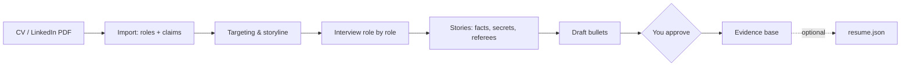

# cv-interview

An [Agent Skill](https://agentskills.io) that interviews senior engineering leaders and
Staff+/Principal engineers about their careers and turns a vague CV into verified,
quantified evidence.

Give it your existing CV or LinkedIn profile. It reads it, proposes the storyline it sees,
then asks one question at a time to find the facts behind each claim: what you were
responsible for and how big it was, what you personally decided, the measured outcome, and who could confirm it.
It stores the facts in a structured evidence base and drafts bullets you approve.

It does not render a CV. The evidence base is plain YAML with an optional
[JSON Resume](https://jsonresume.org) export, so any renderer can read it, including
Typst templates such as [`altacv`](https://typst.app/universe/package/altacv).

**Before** (imported):

> Led platform consolidation

**After** (interview, approved):

> Consolidated three deployment stacks into one platform, cutting lead time from 9 days to 1
> and enabling two product launches in 12 months

Behind that bullet, the evidence base also records the situation, Jane's own decision, a
referee, a confidential budget figure that must never be printed, and one thing the bullet
must not imply. See [examples/jane-doe](examples/jane-doe).

## Who it is for

VP / Head of Engineering, CTO-track, and Principal / Staff+ IC candidates. The method
(`skills/cv-interview/references/method.md`) is built from what executive recruiters,
search briefs and Staff+ guidance actually screen for, with sources.

## Install

Copy `skills/cv-interview/` into your agent's skills directory:

- Claude Code: `~/.claude/skills/cv-interview/` (all projects) or `.claude/skills/cv-interview/`
  (one project).
- Other agents that support Agent Skills: see their documentation for the skills directory.

## Use

Start a session in an empty, **private** directory or repository and say for example:

> Let's improve my CV. Here is my current one: cv.pdf

LinkedIn: on your profile, choose *More → Save to PDF*, or request your data export in the
LinkedIn settings. A bare profile URL usually cannot be read without logging in.

The interview spans several sessions. State lives in `cv-evidence/interview-log.md`, so a new
session continues where the last one stopped ("continue my CV interview").

## Workflow

## Evidence base

| File | Holds | Printable |
|---|---|---|
| `interview-log.md` | Phase, targeting, storyline, coverage, open follow-ups | No |
| `profile.yaml` | Contacts, CV languages, positioning (tracks, headlines, summaries), education, certifications, languages | Partly |
| `roles.yaml` | Every role with scope line and every candidate bullet | Yes |
| `stories.yaml` | The facts behind bullets, `secret` figures, `do_not_claim` caveats, referees | Never |
| `talks.yaml` | Talks, workshops, writing, open source | Yes |

Schema: [`skills/cv-interview/references/schema.md`](skills/cv-interview/references/schema.md).
Every printable text can exist in several languages, and each language must be approved
separately.

## Privacy

Stories contain confidential numbers, names of referees and candid context. Keep your evidence
base in a private repository. The `secret` list prevents those strings from reaching
printable text or exports; it does not protect the YAML files themselves.

## License

MIT, see [LICENSE](LICENSE). Research sources are cited in `method.md`.
